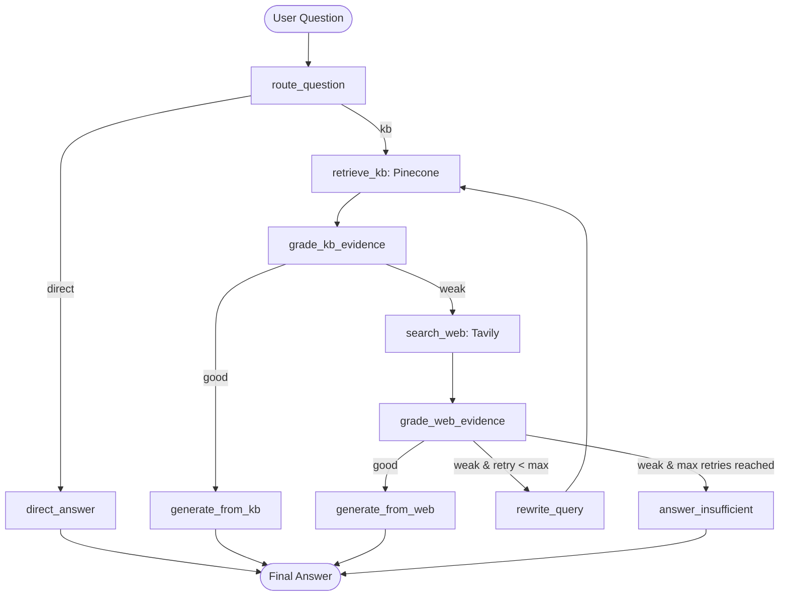

# Industry-Style Agentic RAG with LangGraph & Streamlit

A production-oriented implementation of **Agentic Retrieval-Augmented Generation (RAG)** built with **LangGraph**, **Groq**, **Pinecone**, **Tavily Search**, and an interactive **Streamlit** Web UI.

---

## Architecture & Workflow

Unlike naive RAG that blindly trusts a single vector search, this agentic architecture implements an adaptive fallback loop with quality evaluation:



### Key Capabilities
1. **Private PDF Research KB First**: Queries 47 research papers on Federated Learning, Intrusion Detection, and Cybersecurity indexed in Pinecone.
2. **Evidence Grading**: Structured JSON verification of retrieved context relevance before generating answers.
3. **Web Fallback**: Automatically invokes Tavily Search API when the private papers lack sufficient evidence.
4. **Query Rewriter**: Reformulates ambiguous queries when both KB and web search evidence are weak.
5. **Loop Guard**: Maximum retry limit to prevent infinite search loops.
6. **Transparent Source Tracking & Citations**: Identifies whether the answer came from `private_kb`, `web_search`, or `direct`, citing paper filenames and page numbers.
7. **Streamlit Interactive UI**: Real-time chat interface showing the full agent reasoning trace.
8. **Persistent SQLite Database (`db.sqlite3`)**: Automatically saves all chat messages, sources, and reasoning traces with multi-turn conversational memory.

---

## Project Structure

```text
Agentic_Rag/
├── .env                  # API keys configuration (Groq, Pinecone, Tavily, HF Token)
├── .env.example          # Template for environment variables
├── requirements.txt      # Project dependencies (LangGraph, LangChain, Streamlit, etc.)
├── db.sqlite3            # Persistent SQLite database storing chat messages & traces
├── pdf/                  # Private Knowledge Base: 47 research papers (.pdf)
├── database.py           # SQLite persistence layer (save, load, clear messages)
├── config.py             # Config settings, lazy client initializers, key checks
├── ingest.py             # PDF loader (pypdf), chunking, and batched Pinecone vector indexing
├── graph.py              # LangGraph state graph, nodes, grading, and routing logic
├── app.py                # Streamlit Web UI with chat, streaming, and DB integration
├── main.py               # CLI entry point (terminal chat, demos, ingestion, UI launcher)
└── README.md             # Documentation & usage guide
```

---

## Setup & Installation (Without Conda)

You do **not** need Conda. Standard Python `venv` and `pip` are used.

### 1. Create and Activate Virtual Environment

**Windows (PowerShell):**
```powershell
python -m venv venv
.\venv\Scripts\activate
```

**Linux / macOS:**
```bash
python3 -m venv venv
source venv/bin/activate
```

### 2. Install Dependencies

```powershell
pip install -r requirements.txt
```

### 3. Configure API Keys in `.env`

Open [.env](file:///e:/projects/Agentic_Rag/.env) and populate your keys:

```env
GROQ_API_KEY=gsk_...
TAVILY_API_KEY=tvly-...
PINECONE_API_KEY=pcsk_...
HF_TOKEN=hf_...
```

---

## Running the Application

### Option A: Launch the Streamlit Web UI (Recommended)

Run either:
```powershell
streamlit run app.py
```
Or:
```powershell
python main.py --ui
```

This opens your browser with:
- Interactive chat interface
- Live visual badges for source (`Private PDF KB` vs `Tavily Web Fallback` vs `Direct`)
- Collapsible **"Agent Decision & Evidence Trace"** showing router decision, chunk snippets, paper filenames, page numbers, and grades
- Sidebar button to index / re-index your 47 PDFs into Pinecone with one click

---

### Option B: Command Line Interface (CLI)

1. **Ingest PDFs into Pinecone (one-time)**:
   ```powershell
   python ingest.py
   ```
2. **Interactive Terminal Chat**:
   ```powershell
   python main.py
   ```
3. **Run Predefined Demos**:
   ```powershell
   python main.py --demo
   ```
4. **Single Question via CLI**:
   ```powershell
   python main.py --query "How does federated learning detect network intrusions?"
   ```
